<p align="center">
  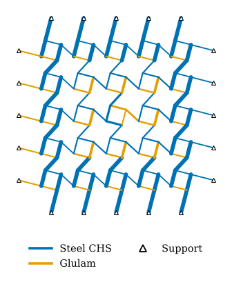
</p>

<h1 align="center">QUBO sizing of multi-material reciprocal frames<br>for carbon, energy and stiffness</h1>

<p align="center">
  
  
  
</p>

Code, data and results for the paper

> N. Praphaphankul, *Carbon, energy and stiffness trade-offs in multi-material reciprocal frames: a stress-gated QUBO formulation with constructability coupling*, submitted to *Engineering Structures*, 2026.

Every member group of a three-dimensional reciprocal frame (nexorade) chooses both its **material** and its **section** from a catalogue of steel circular hollow sections, glulam rectangles and, optionally, reclaimed steel lots. The choice is written as a quadratic unconstrained binary optimisation (QUBO) with three objectives, **embodied carbon**, **embodied energy** and **virtual work of the loads**, and solved by simulated annealing against an NSGA-II baseline at the same number of finite-element analyses. Everything runs with `numpy` only; `matplotlib` is needed for the figures.

## Contents

1. [Problem](#problem)
2. [Theory](#theory)
3. [Quick start](#quick-start)
4. [Repository layout](#repository-layout)
5. [Experiments and results](#experiments-and-results)
6. [Reproducing the figures](#reproducing-the-figures)
7. [Data formats](#data-formats)
8. [Citation and licence](#citation-and-licence)

## Problem

A reciprocal frame spans a large area with short members that rest on one another. Because the members are short they can be glulam, standard steel tubes, or a mixture, and the material that minimises carbon at one position is not the one that minimises it elsewhere: glulam carries about one quarter of the carbon of steel per kilogram but one twentieth of the stiffness, and its low torsional stiffness matters at the eccentric bearings that define the typology.

The sizing problem is combinatorial. With `n_g` member groups and `n_s` catalogue options there are `n_s^n_g` designs, each needing a 12-DOF frame analysis with bending, torsion and eccentric bearing links. The five frames studied are:

| Case | Groups | Nodes | Members | Load per hub (N) | Span (m) |
|---|---|---|---|---|---|
| Fan unit | 4 | 12 | 8 | 2200 | 2.0 |
| 3 x 3 square nexorade | 8 | 40 | 28 | 450 | 7.5 |
| 6 x 6 square nexorade | 12 | 220 | 160 | 450 | 15.0 |
| Hexagonal nexorade | 9 | 327 | 240 | 1400 | 12.0 |
| Reciprocal dome | 9 | 327 | 240 | 3500 | 18.5 |

<p align="center">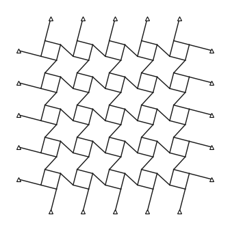 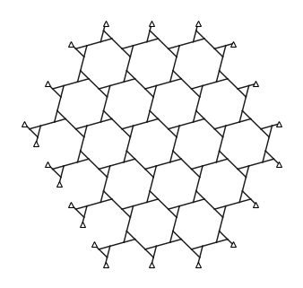 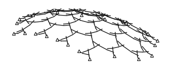</p>

## Theory

### Catalogue and environmental factors

`data/catalogue_and_factors.json` lists the 16 new options (8 EN 10210 CHS in S355, 8 GL24h glulam rectangles with depth 2b) and 4 reclaimed CHS lots, with per-metre mass, bending stiffness, carbon and energy. Cradle-to-gate factors per kilogram (modules A1 to A3):

| Material | Carbon (kgCO2e/kg) | sd | Energy (MJ/kg) | Design strength (MPa) | k_def |
|---|---|---|---|---|---|
| Steel section, world average (ICE v3) | 1.55 | 0.35 | 21.5 | 355 | 0 |
| Steel, electric-arc-furnace (ICE v2) | 0.47 | 0.15 | 10.0 | 355 | 0 |
| Reclaimed steel, fabrication share | 0.10 | 0.05 | 1.5 | 275 | 0 |
| Glulam GL24h, fossil only (ICE v2) | 0.42 | 0.15 | 12.0 | 15.4 | 0.6 |
| Glulam with biogenic storage credit (-1/+1) | -1.20 | 0.30 | 12.0 | 15.4 | 0.6 |

Within one material carbon, energy and mass are proportional, so a single-material front is two-dimensional. Across materials the carbon-to-energy ratio is 0.072 for steel, 0.035 for glulam and 0.067 for reclaimed steel, and the stiffness per unit carbon differs widely, which is what makes the three-objective front genuinely three-dimensional.

<p align="center">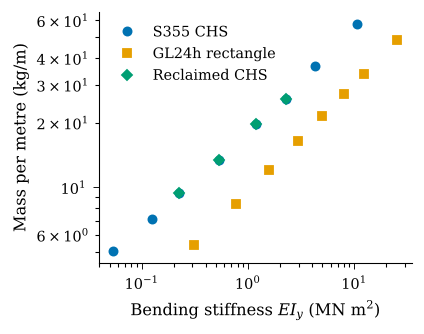 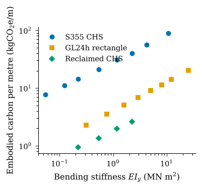</p>

### Binary variables and objectives

Let `x_kc = 1` when group `k` uses option `c`, with the one-hot condition `sum_c x_kc = 1`. With `L_k` the member length of group `k`:

```
f1 = sum_kc e_c L_k x_kc + beta * sigma(x)          embodied carbon (robust form with beta >= 0)
f2 = sum_kc q_c L_k x_kc                             embodied energy
sigma^2(x) = sum_m ( sum_k sum_{c in m} s_c L_k x_kc )^2   carbon standard deviation
f3 = W(x) = F^T u(x)                                 virtual work of the loads, from a frame analysis
```

`e_c`, `q_c` and `s_c` are the carbon, energy and carbon-deviation per metre of option `c`; the factor of one material is treated as fully correlated across its members and independent between materials, so `sigma^2` is quadratic in `x` and QUBO-native.

### Frozen-field linearisation

One real analysis per iteration gives the displacement vector `u`. Under a frozen displacement field the strain energy that the elements of group `k` would store with option `c` is

```
S_kc = 1/2 * sum_{i in k} u_i^T k_i(c) u_i
```

and because `k_i` is linear in `EA`, `EI_y`, `EI_z` and `GJ`, all options are evaluated from four unit stiffness matrices per element (`local_stiffness(1, 1, A, Iy, Iz, J, L)` with one property set to one). A stiffer option stores more energy under the same displacement and lowers the virtual work after re-analysis, so

```
delta f3  ~  -2 * sum_kc ( S_kc - S_k,c_k ) x_kc
```

with `c_k` the current option. A move limit of three positions in the mass-sorted catalogue keeps the linearisation in its region of validity. On the hexagonal nexorade the surrogate predicts the sign of 128 of 135 single-group moves; it overstates stiffening gains by a median factor of 2.5 and understates softening losses, which is why the move limit is needed (`figures/fig15_a.png`).

### Frozen-force stress gate

The member end forces of the current analysis give, for every element `i` of group `k` and every option `c`,

```
U_ic = ( N_i / A_c + (M_y,i + M_z,i) D_c / (2 I_c) ) / f_d,c        U_kc = max_i U_ic
```

Options with `U_kc > 1` receive a large linear penalty inside the QUBO (unless no option of the group passes). The gate is conservative for a single move (no over-stressed option passes, a few near-limit ones are withheld) and every candidate design is re-checked by the real analysis before it enters the front. On the heavily loaded hexagonal nexorade the gate raises the share of feasible evaluations from 15 % to 88 %.

<p align="center">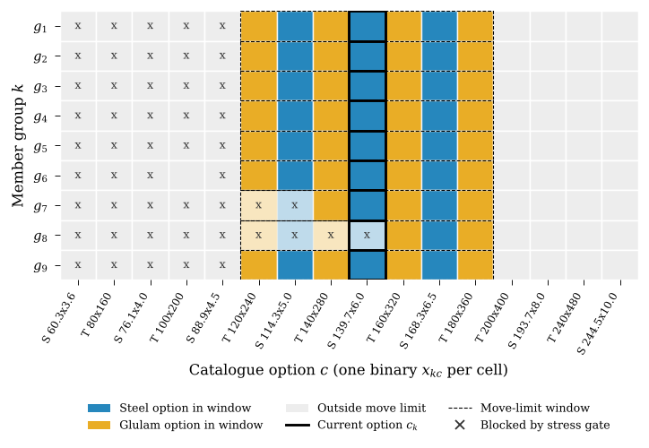</p>

### Scalarisation

Objectives are normalised with bounds from the uniform designs. For a weight vector `lambda` on the simplex:

* **Weighted sum (WS):** minimise `lambda^T f_norm(x)`, linear in `x` apart from the penalties.
* **Penalty boundary intersection (PBI):** minimise `lamhat^T f + theta * || (I - lamhat lamhat^T) f ||^2`. Because `f` is linear in `x` under the frozen field, the perpendicular term is exactly quadratic in `x` and couples every pair of variables (`theta = 0.3`).

<p align="center">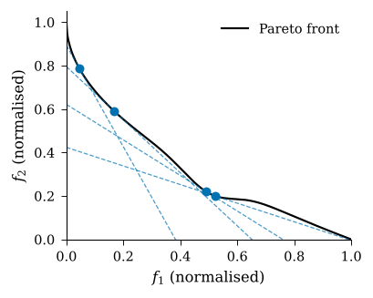 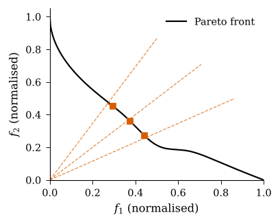</p>

### Quadratic couplings

* **Standardisation:** an indicator `y_c` per option, the implication `x_kc <= y_c` as the penalty `P x_kc (1 - y_c)`, and a cost `lambda_t sum_c y_c` that buys fewer distinct section types.
* **Reclaimed-lot exclusivity:** each lot may equip at most one group, `P sum_{k<l} x_kc x_lc` for every lot `c`.

Both make the QUBO non-separable across groups, which is what makes an annealer necessary rather than convenient. The resulting matrix for the fan unit (80 binaries, 66 % non-zero) is shown in `figures/fig14_b.png`.

### Solver, baseline and metrics

The QUBO is solved by simulated annealing (`qubo.sa_solve`, 25 reads of 120 sweeps); the loop stops when the assignment repeats or after ten iterations. A Pareto sweep uses the 15 weight vectors of the simplex with step 0.25, at most 165 real analyses. NSGA-II (`qubo.nsga2`, population 24) is run with the same 165 analyses. Fronts are compared by Monte Carlo hypervolume in normalised space with reference point `(1.05, 1.05, 1.05)`, by inverted generational distance to the exact front where it exists, and by the share of the combined front each method contributes.

<p align="center">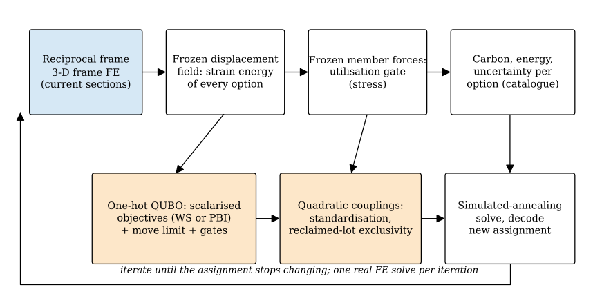</p>

## Quick start

```bash
python3 -m pip install numpy matplotlib
python3 src/frame3d.py          # FE self-test against beam theory (< 1 s)
python3 src/aggregate.py        # rebuild data/aggregate_v2.json from the 130 raw result files (~1 min)
python3 src/make_figures.py && python3 src/make_figures2.py && python3 src/make_figures3.py   # all 54 panels (~3 min)
```

To re-run the whole campaign from scratch (about 1.5 h on a laptop; resumable, finished jobs are skipped):

```bash
./run_all.sh
```

`run_jobs.py` also accepts `BUDGET SHARD NSHARDS GUARD` to run several processes in parallel on disjoint job subsets.

Minimal use of the library:

```python
import sys; sys.path.insert(0, 'src')
import mo2_lib as L
model, load, span = L.model('sq3')                 # 3 x 3 nexorade
cat = L.catalogue(steel='steel', timber='glulam')  # 8 CHS + 8 GL24h rectangles
GL = L.group_len(model, L.lengths(model))
space = L.Space(model, cat, load, GL)              # normalisation bounds from uniform designs
log = []
for lam in L.simplex(4):                           # 15 weight vectors
    L.qubo_run(space, lam, 'pbi', log=log)         # frozen-field QUBO with stress gate, SA solve
front = L.front(log)                               # feasible non-dominated designs
print(len(front), L.hv3([r['Fn'] for r in front]))
```

## Repository layout

```
src/
  frame3d.py            12-DOF 3-D frame finite-element solver
  reciprocal_geom.py    model container, bearing links, build_frame, model_mass
  reciprocal_geom_v2.py typologies: fan_unit, square_nexorade, hex_nexorade, rf_dome, ...
  sections.py           EN 10210 CHS catalogue and steel properties
  fastsolve.py          banded Cholesky fast path
  qubo.py               QUBO builder, simulated annealing, NSGA-II, Pareto utilities
  sizing.py             frozen-field strain-energy cache and single-material sizing
  mo2_lib.py            multi-material catalogue, factors, objectives, stress gate, WS/PBI QUBO, couplings, creep
  run_jobs.py           resumable campaign (exact enumeration, E1 to E7)
  aggregate.py          builds data/aggregate_v2.json from data/results/*.json
  figstyle.py, make_figures*.py   figure scripts (54 panels) and the audit file data/manuscript_numbers.json
data/
  catalogue_and_factors.json   the 20 options and the material factors
  results/                     130 raw result files, one per job
  aggregate_v2.json            fronts, hypervolumes, IGD, traces
  manuscript_numbers.json      every number quoted in the paper, generated by the figure scripts
figures/                       all panels as PNG (PDF versions are produced by the scripts)
paper_tables/                  LaTeX tables generated from the data
```

## Experiments and results

| Job | Case | What it tests |
|---|---|---|
| E1 | fan unit | exact enumeration of all 65,536 designs; WS, PBI and NSGA-II at 165 analyses, 5 seeds |
| E2 | 3 x 3 nexorade | three accounting scenarios: fossil-only, biogenic credit, EAF steel; 5 seeds |
| E3 | 6 x 6, hexagonal, dome | scaling and the stress gate; 3 seeds |
| E4 | 6 x 6 | standardisation coupling, `lambda_t` from 0 to 0.4 |
| E5 | 6 x 6 | reclaimed lots with and without the exclusivity coupling |
| E6 | 3 x 3 | robust carbon objective, `beta` = 0, 1, 2 |
| E7 | 3 x 3 | serviceability limit L/250 with instantaneous and long-term (creep) glulam stiffness |

Hypervolume (mean over seeds, reference 1.05^3; exact value on the fan unit 1.089):

| Case | WS-QUBO | PBI-QUBO | NSGA-II |
|---|---|---|---|
| Fan unit | 1.073 | 1.057 | 1.026 |
| 3 x 3, fossil-only | 1.071 | 1.061 | 1.024 |
| 3 x 3, biogenic credit | 1.005 | 0.997 | 0.939 |
| 3 x 3, EAF steel | 1.020 | 1.026 | 0.981 |
| 6 x 6 | 0.989 | 0.999 | 0.924 |
| Hexagonal | 0.898 | 0.908 | 0.811 |
| Dome | 0.951 | 0.951 | 0.861 |

Key findings:

* The WS-QUBO front reaches 98.5 % of the exact hypervolume of the enumerated fan unit with 165 of 65,536 analyses.
* On the three largest frames the QUBO fronts exceed NSGA-II by 7 to 12 % in hypervolume with less seed-to-seed scatter; PBI is marginally better than WS on the larger, more constrained frames and not on small convex fronts.
* The stress gate keeps 88 to 100 % of evaluations feasible; NSGA-II reaches 33 % on the hexagonal nexorade.
* The lot-exclusivity coupling removes every duplicate assignment (0 in 198 designs) where the uncoupled search violates the lot limit in 86 % of designs, and lowers the minimum carbon by 12 %.
* Standardisation reduces the number of section types from seven to four at a cost of 10 to 63 % in the scalarised objective.
* Timber creep (`k_def` = 0.6) raises the minimum carbon under L/250 by a third and shifts one group from timber to steel; carbon-factor uncertainty barely moves the front; the biogenic convention changes the sign of the timber objective.
* Along the fronts glulam fills the outer rings and steel enters one member family of the inner rings first.

<p align="center">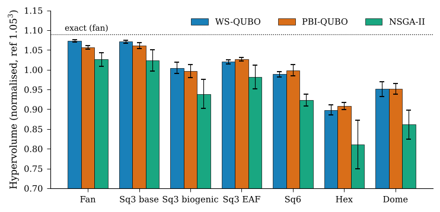</p>
<p align="center">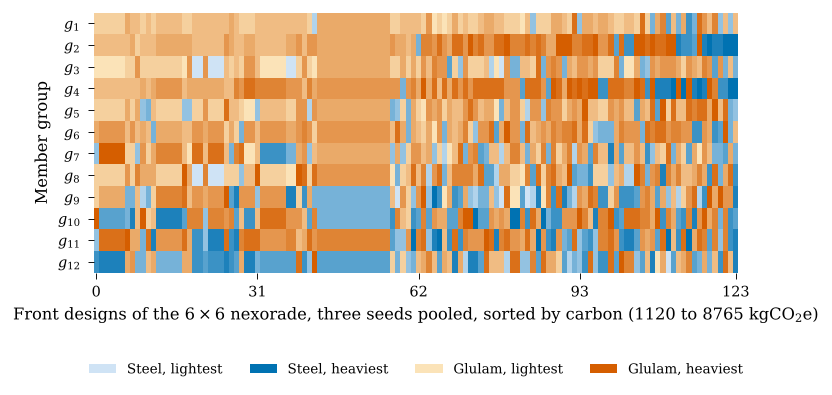</p>
<p align="center">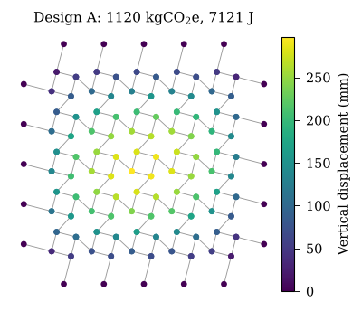 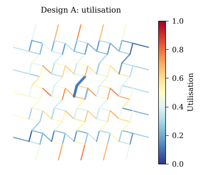</p>

## Reproducing the figures

`make_figures.py` draws the campaign panels from `data/aggregate_v2.json`; `make_figures2.py` adds the surrogate and gate validation (it re-runs about 300 frame analyses), the budget curves and the pooled fronts; `make_figures3.py` adds the encoding grid, the 3-D objective space, the displacement and utilisation maps and the catalogue heat map. Together they write `data/manuscript_numbers.json`, which holds every number quoted in the paper so that the text can be audited against the data.

## Data formats

Each raw result `data/results/<job>.json` holds, for a method run, `n_eval`, `n_feas`, `hv`, `time`, `front` (feasible non-dominated designs) and `all` (every evaluated design, in evaluation order). A design record is

```json
{"idx": [8, 3, 11, ...], "ec": 1120.4, "ecsd": 243.1, "ee": 28840.7, "vw": 7121.5,
 "util": 0.79, "umax": 0.297, "feas": true, "Fn": [0.07, 0.08, 0.18]}
```

with `idx` the option index of every group in the mass-sorted catalogue of that run (16 options for new material, 20 with reclaimed lots), `ec` carbon in kgCO2e, `ecsd` its standard deviation, `ee` energy in MJ, `vw` virtual work in J, `util` the peak utilisation, `umax` the largest nodal displacement in m and `Fn` the normalised objective vector. The exact enumeration (`E1_exact_*.json`) stores `rows` of `[idx, ec, ee, vw, util, umax]`.

## Citation and licence

```bibtex
@article{praphaphankul2026carbon,
  author  = {Praphaphankul, Nitipong},
  title   = {Carbon, energy and stiffness trade-offs in multi-material reciprocal frames: a stress-gated {QUBO} formulation with constructability coupling},
  journal = {Engineering Structures},
  year    = {2026},
  note    = {under review}
}
```

MIT licence. The frame solver, the typologies and the annealer are shared with the companion single-material study of reciprocal frames by the same author.
